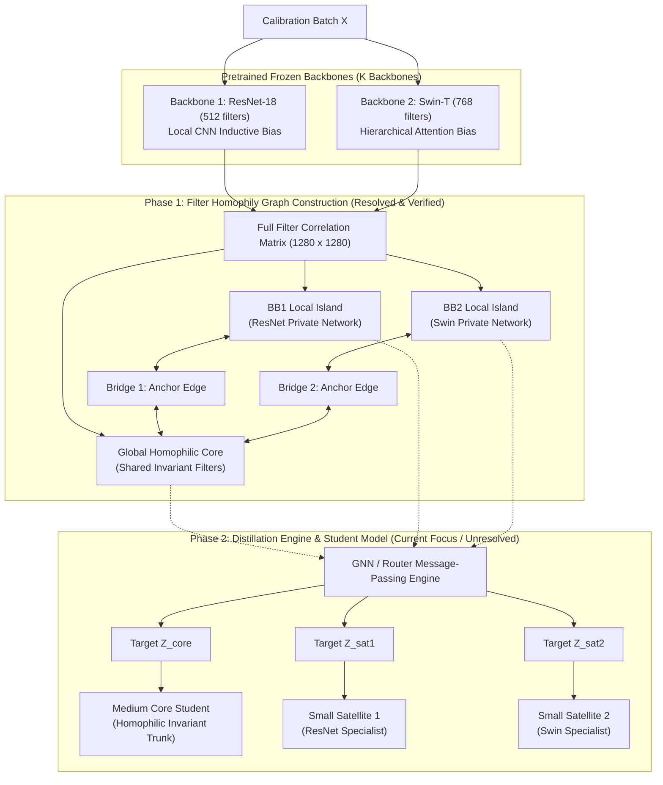

# Homophily-Heterophily Multi-Backbone Knowledge Distillation (HH-MTKD)
## Architectural Blueprint & Theoretical Framework

---

### 1. Executive Summary & Conceptual Vision

Standard multi-teacher knowledge distillation (MT-KD) forces heterogeneous backbones (e.g., ConvNets with local translation equivariance vs. Vision Transformers with global self-attention) into a monolithic student or averages their predictions, causing **destructive interference** among conflicting inductive biases.

This framework introduces a **topological disentanglement paradigm based on Filter Function Homophily**:
1. **Filter Functions as Graph Nodes**: Rather than building an image-to-image sample graph, the graph operates directly on the space of **filter functions** ($N = D_1 + D_2 + \dots + D_K$).
2. **Data-Driven Functional Homophily**: Without assuming arbitrary coordinate alignment (e.g. Filter 0 does not match Filter 0), edges are established via empirical cross-model filter co-activation across the data manifold.
3. **Multi-Community Graph Topology with Heterophilic Bridges**:
   - **Global Homophilic Core**: Densely connected clique of filter functions from diverse backbones that agree on invariant visual primitives (e.g., object contours, class-level semantics).
   - **Backbone-Specific Local Islands**: Specialized filters that do not cross the agreement threshold form their own internal local homophilic networks, preserving CNN- or Transformer-specific biases.
   - **Heterophilic Bridges**: Sparse, maximal-affinity anchor edges bridging each local island to the global core.
4. **Target Student Architecture (Under Design)**:
   - A **Medium Core Trunk** trained on the Global Homophilic Core.
   - **$K$ Small Parallel Satellite Modules** trained on the respective Backbone-Specific Local Islands.

---

### 2. High-Level System Architecture

---

### 3. Mathematical Formulation of Graph Construction

#### 3.1 Node Definition: Filter Functions
Let $K$ be the number of teacher backbones. Each backbone $k$ possesses $D_k$ filter functions before global pooling:
$$\mathcal{F}_k = \{ f_1^{(k)}, f_2^{(k)}, \dots, f_{D_k}^{(k)} \}$$
The complete graph has $N = \sum_{k=1}^K D_k$ nodes, where each node represents an individual filter function $f_i$.
For our two-teacher configuration:
- Backbone 1 (ResNet-18): 512 filter functions (Nodes $0 \dots 511$)
- Backbone 2 (Swin-T): 768 filter functions (Nodes $512 \dots 1279$)
- Total Nodes: $N = 1280$

#### 3.2 Edge Definition: Functional Co-Variation over the Data Distribution
Because internal coordinate indices and basis rotations between a CNN and a Vision Transformer are arbitrary, edges are defined by empirical functional correlation across calibration samples $X \in \mathbb{R}^{B \times C \times H \times W}$:

1. **Activation Standardization**:
   For the combined activation matrix $F \in \mathbb{R}^{B \times N}$:
   $$\tilde{F} = \frac{F - \mu(F)}{\sigma(F) + \epsilon}$$
2. **Empirical Correlation Matrix ($N \times N$)**:
   $$\mathbf{C} = \frac{1}{B - 1} \tilde{F}^T \tilde{F}$$
   where $\mathbf{C}_{ij}$ quantifies the functional agreement between filter function $i$ and filter function $j$.

3. **Multi-Community Partitioning**:
   - **Cross-Model Submatrix**: $\mathbf{C}_{\text{cross}} = \mathbf{C}_{[:D_1, D_1:]}$.
   - **Global Core Nodes ($V_{\text{core}}$)**: Filters that achieve strong cross-model correlation:
     $$V_{\text{core}} = \{ i \in \text{BB1} \mid \max_j |\mathbf{C}_{ij}| \ge \tau \} \cup \{ j \in \text{BB2} \mid \max_i |\mathbf{C}_{ij}| \ge \tau \}$$
   - **Local Specialist Nodes ($V_{\text{local}}^{(k)}$)**: Filters unique to Backbone $k$ ($\max |\mathbf{C}| < \tau$).

4. **Adjacency Matrix Construction ($\mathbf{A} \in \mathbb{R}^{N \times N}$)**:
   - **Self-Loops**: $\mathbf{A}_{ii} = 1.0$.
   - **Intra-Community Homophily**:
     For $u, v \in V_{\text{core}}$, $\mathbf{A}_{uv} = |\mathbf{C}_{uv}|$ if $|\mathbf{C}_{uv}| \ge \tau$.
     For $u, v \in V_{\text{local}}^{(k)}$, $\mathbf{A}_{uv} = |\mathbf{C}_{uv}|$ if $|\mathbf{C}_{uv}| \ge \tau_{\text{local}}$.
   - **Heterophilic Anchor Bridges**:
     For each local island $V_{\text{local}}^{(k)}$, exactly one maximal-affinity bridge is formed to the core:
     $$(u^*, v^*) = \arg\max_{u \in V_{\text{local}}^{(k)}, v \in V_{\text{core}}} |\mathbf{C}_{uv}|, \quad \mathbf{A}_{u^* v^*} = \mathbf{A}_{v^* u^*} = |\mathbf{C}_{u^* v^*}|$$

---

### 3.2.1 Empirical Validation (CIFAR-10 Experiments)

Evaluated on 1024 CIFAR-10 images with pretrained ImageNet weights ($\tau = 0.30$, $\tau_{\text{local}} = 0.40$):
- **Global Homophilic Core**: 599 nodes (46.8%)
- **ResNet-18 Local Island**: 277 nodes (21.6%)
- **Swin-T Local Island**: 404 nodes (31.6%)
- **Anchor Bridges**:
  - Bridge 1: ResNet Local Node 228 $\leftrightarrow$ Core Node 204 (Weight: 0.5595)
  - Bridge 2: Swin Local Node 698 $\leftrightarrow$ Core Node 700 (Weight: 0.5051)

**Qualitative Visual Proof**:
- Rank-1 Core Pair: `ResNet-18 Filter [255]` $\leftrightarrow$ `Swin-T Filter [610]` (Corr: 0.5287).
- 2D pre-pooling spatial feature maps confirm both filters produce identical spatial activation hotspots specifically on amphibians (frogs/toads) and foliage, confirming true semantic invariance.

---

### 3.3 The Knowledge Distillation Stage (Under Active Design)

The graph construction phase is complete and verified. The following components define the distillation engine and require design resolution:

#### Open Design Questions:
1. **GNN Distillation Message Passing**:
   - How do node states update over $\mathbf{A}$ for each input image $x$?
   - How do messages propagate across the bridge without washing out the local specialist signals?
2. **Distillation Targets Extraction**:
   - Pooling $V_{\text{core}}$ into $Z_{\text{core}}$ for the Medium Core Student.
   - Pooling $V_{\text{local}}^{(1)}$ and $V_{\text{local}}^{(2)}$ into $Z_{\text{sat1}}$ and $Z_{\text{sat2}}$ for the Satellite Modules.
3. **Student Model Architecture**:
   - Trunk backbone capacity (e.g. ResNet-18 / MobileNet-V4).
   - Satellite adapter capacity (e.g. 2-layer MLP bottleneck / lightweight residual depthwise blocks).
   - Fusion mechanism: Gated linear unit, dynamic attention, or residual additive projection.
4. **Loss Function Formulation**:
   - Combination of task loss (CE), homophilic core loss (MSE / CKA), and heterophilic residual loss.
